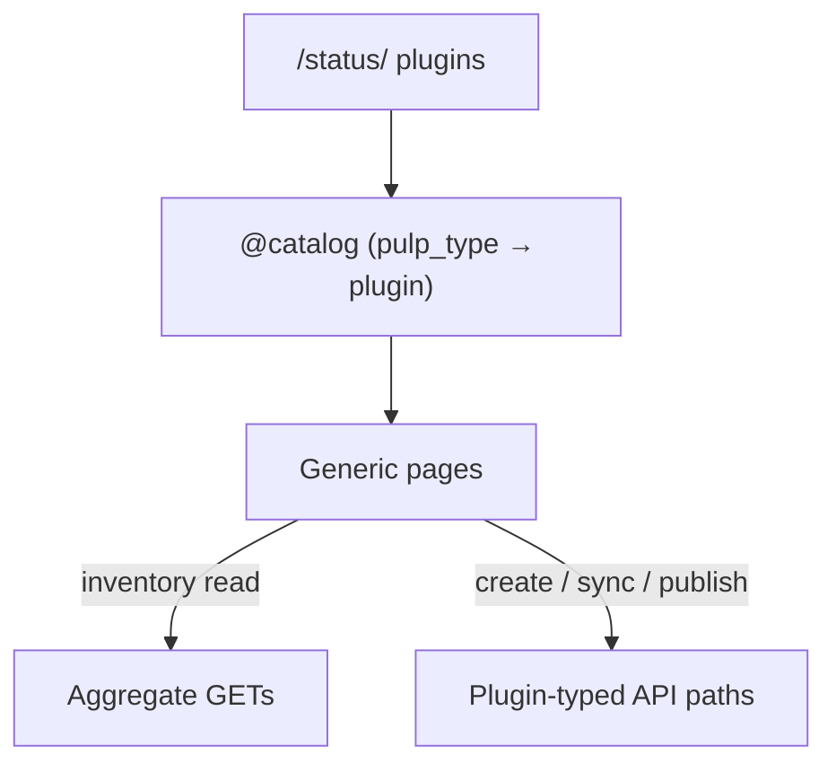

# Architecture

**Core idea:** the UI is **plugin-agnostic**. Screens follow pulpcore concepts
(Remote, Repository, Publication, Distribution, Content, Task), not plugin names.
One generic page per concept renders every plugin; plugin differences come from
the **catalog** (`client/src/catalog`, imported as `@catalog`), never from
per-plugin page trees.

## Why generic pages

- Pulp's aggregate endpoints (`/repositories/`, `/content/`, …) are inventory only.
  Create, sync and publish need **plugin-typed** paths (`/repositories/file/file/`, …).
- A per-plugin page tree doesn't scale to "one UI for all plugins".
- The catalog bridges the two: aggregate lists for reads, catalog-resolved typed
  paths for writes.

## How it works

1. **Discover plugins** at boot from `/status/` → `ApiStatusContext`
   (`plugins`, `isPluginInstalled`).
2. **The catalog** is data only: one file per plugin in `catalog/plugins/` plus shared
   `base-fields.ts`, assembled in `catalog/index.ts` and keyed by `pulp_type`. Each
   plugin declares `isAvailable`, its REST `apiPath`, create/edit fields per entity
   (`repository`, `remote`, `distribution`, `publication`), repository
   `compatibleRemoteTypes` / `compatiblePublicationTypes`, and its `content` types.
3. **Generic pages** resolve the catalog entry from a row's `pulp_type` (or its href's
   `apiPath`) to decide which actions exist and which typed endpoint to call.
   Create/edit modals use `PluginForm` (`EntityModalShell` + `EntityModalBody`, wizard
   or plain from `form.isWizard`).
4. **Create is gated on installed plugins** (`useCreatablePlugins` /
   `getAvailablePlugins`). Types the catalog doesn't model still appear in lists but
   stay read-only.
5. **Per-type presentation is a UI-layer registry**, not catalog data. Example:
   `PluginContentPanel` maps each content `pulp_type` to a typed React component.
6. **Add a plugin:** one file under `catalog/plugins/` and an entry in
   `pluginDefinitions`. No new routes or nav. See [CONTRIBUTING.md](../CONTRIBUTING.md).

## Data access

- TanStack Query hooks live in `client/src/app/queries/`, one file per domain.
- Queries take **hrefs**. Only route `loader`s turn URL ids into hrefs
  (`build*Href`). See "Hrefs, ids and query keys" in [AGENTS.md](../AGENTS.md).
- Routes are domain-scoped: `/content-management/$pulpDomain/…` and
  `/monitoring/$pulpDomain/…`. Pick the domain with `DomainContextSelector`.

## Code map

| Path                                       | What                                                        |
| ------------------------------------------ | ----------------------------------------------------------- |
| `client/src/catalog/`                      | plugin catalog (data only)                                  |
| `client/src/routes/`                       | file-based routes; loaders build hrefs                      |
| `client/src/app/pages/content-management/` | Remotes, Repositories, Publications, Distributions, Content |
| `client/src/app/pages/tasks/`              | task list and detail                                        |
| `client/src/app/pages/admin/`              | Users, Groups, Roles                                        |
| `client/src/app/pages/system-management/`  | Domains, Signing Services                                   |
| `client/src/app/components/`               | shared UI (DataView helpers, PluginForm, …)                 |
| `client/src/app/context/`                  | ApiStatus, Auth, Notifications, Theme                       |

## Related

- [AGENTS.md](../AGENTS.md): coding conventions (layout, queries, hrefs, imports)
- [evals/](../evals/): convention specs checked by `/eval` (queries, forms, toasts, signatures)
- [UI_ENTITIES.md](UI_ENTITIES.md): screens, routes and how entities connect
- [CONTENT_ENTITY_RELATIONSHIPS.md](CONTENT_ENTITY_RELATIONSHIPS.md): the backend model
- [CONTENT_UI_DESIGN.md](CONTENT_UI_DESIGN.md): Content surfaces and upload plan
- [A11Y_PERF.md](A11Y_PERF.md): deferred a11y/perf work
