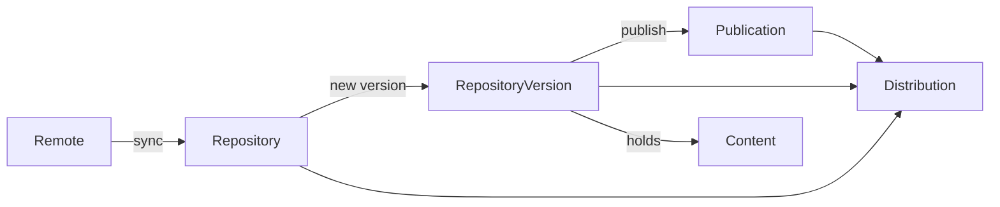

# UI entities and relationships

What each screen is for and how the entities connect. For the mechanics, see
[ARCHITECTURE.md](ARCHITECTURE.md). For the backend model, see
[CONTENT_ENTITY_RELATIONSHIPS.md](CONTENT_ENTITY_RELATIONSHIPS.md).

## Navigation

| Nav group          | Entities                                                    |
| ------------------ | ----------------------------------------------------------- |
| Main               | Dashboard                                                   |
| System Management  | Domains, Signing Services                                   |
| Content Management | Remotes, Repositories, Publications, Distributions, Content |
| Monitoring         | Tasks                                                       |
| Administration     | Users, Groups, Roles                                        |

Content Management and Monitoring routes carry the selected domain
(`$pulpDomain`). In the table below, `…` stands for `/content-management/$pulpDomain`.

## Content lifecycle

Sync, publish and most deletes are async. They return a **Task**, which shows up as
row-level status in lists and under Tasks.

## Content management

| Entity            | Routes                                                                 | Detail shape                                                                                           |
| ----------------- | ---------------------------------------------------------------------- | ------------------------------------------------------------------------------------------------------ |
| Remote            | `…/remotes`, `…/remotes/$remoteType/$remoteId`                         | Page, tabs **Details · Tasks**                                                                         |
| Repository        | `…/repositories`, `…/repositories/$repositoryType/$repositoryId`       | Page, tabs **Details · Versions · Publications · Distributions**. Actions: Sync, Publish, Edit, Delete |
| RepositoryVersion | `…/repositories/$repositoryType/$repositoryId/versions/$versionNumber` | Page: content summary plus a content list with a detail drawer                                         |
| Publication       | `…/publications`                                                       | Expandable row (no route)                                                                              |
| Distribution      | `…/distributions`                                                      | Expandable row (no route). Links to the served content URL                                             |
| Content           | `…/content`, `…/content/$contentType/$contentId`                       | Page, tabs **Details · Artifacts · Repositories**                                                      |

- **Repository** is the hub. Its Details tab shows client setup
  (`PluginRepositoryClientSetup`) and the latest content.
- **Content** is immutable and read-only. Details is rendered per type by
  `PluginContentPanel`. Repositories lists the repositories whose _latest_ version
  contains the unit.
- Sync and publish are offered only when the catalog lists compatible remote or
  publication types for the repository's `pulp_type`.

## Platform

| Entity          | Routes                                             | Notes                                                            |
| --------------- | -------------------------------------------------- | ---------------------------------------------------------------- |
| Dashboard       | `/`                                                | `/status/`: plugins and versions, workers, storage               |
| Task            | `/monitoring/$pulpDomain/tasks`, `…/tasks/$taskId` | State, progress reports, errors. Cancel when running             |
| Domain          | `/system-management/domains`                       | CRUD. Shows an empty state when the backend has domains disabled |
| Signing Service | `/system-management/signing-services`              | Read-only list                                                   |

## Access control (RBAC)

| Entity | Routes                                    | Notes                                                    |
| ------ | ----------------------------------------- | -------------------------------------------------------- |
| User   | `/admin/users`                            | List with create/edit modals and role assignment         |
| Group  | `/admin/groups`, `/admin/groups/$groupId` | Detail tabs **Users · Roles**                            |
| Role   | `/admin/roles`                            | List with create/edit modals. Locked roles are read-only |

## Caveats

1. **Writes need a catalog entry and an installed plugin.** Types the catalog doesn't
   model show in lists but stay read-only.
2. **No upload or add/remove-content yet.** See [CONTENT_UI_DESIGN.md](CONTENT_UI_DESIGN.md).
3. **No permission-aware UI.** Nothing checks `my_permissions` yet. The API enforces RBAC.
