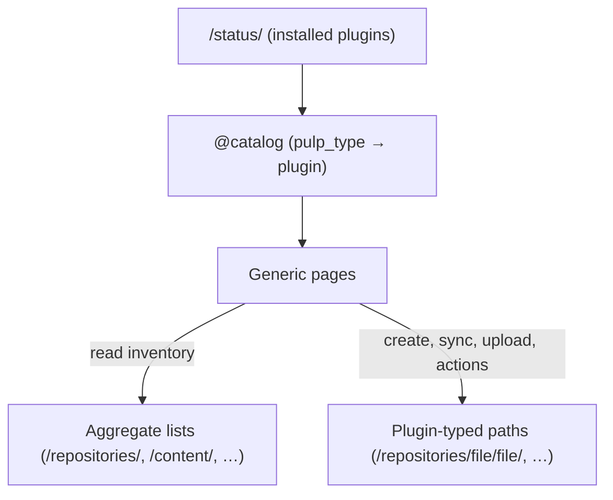

# Architecture

The UI is **plugin-agnostic** ([ADR 0001](../adr/0001-plugin-agnostic-generic-pages.md)). There is
one generic page per pulpcore concept, and every plugin difference comes from the **catalog**
(`client/src/catalog`, imported as `@catalog`).

## The catalog

Data only, never UI. One file per plugin in `catalog/plugins/`, shared field groups in
`base-fields.ts`, assembled by `catalog/index.ts` and resolved per `pulp_type`
(`getPlugin`, `getAvailablePlugins`, `getContentType(s)`). Types are in `catalog/types.ts`.

A plugin (`IPluginDefinition`) declares:

| Key                                                                | What it drives                                           |
| ------------------------------------------------------------------ | -------------------------------------------------------- |
| `app.isAvailable`                                                  | Whether the plugin is installed (gates create and edit)  |
| `rest.pulpType` / `rest.apiPath`                                   | Identity and the typed collection path used for writes   |
| `entities.{repository,remote,distribution,publication}.form`       | Create/edit fields, wizard or plain modal (`isWizard`)   |
| `entities.repository.compatibleRemoteTypes` / `…PublicationTypes`  | Whether Sync / Publish are offered, and with which types |
| `entities.repository.contentChanges` (`modify`/`addRemove`/`null`) | How content is added and removed                         |
| `entities.repository.archiveImport`                                | "Import archive" (OSTree)                                |
| `entities.repository.actions`                                      | Plugin actions (sign, tag, copy…) rendered as task forms |
| `content[]` → `apiPath`, `uploadable` (`upload` / `create`)        | Typed content endpoints and the upload form              |

Variants (a second `pulp_type` for one entity, e.g. `file.git`, `rpm.uln`) are an array slot
whose entries override `rest`; each resolves to its own plugin entry.

Per-type **presentation** lives in UI registries keyed by `pulp_type`, never in the catalog:

| Registry                                          | Maps                                |
| ------------------------------------------------- | ----------------------------------- |
| `components/PluginContentPanel` (`PANEL_BY_TYPE`) | content type → detail panel         |
| `components/PluginBrowse/registry.ts`             | repository type → Browse sections   |
| `repository-detail/components/pluginTabs.ts`      | repository type → extra detail tabs |

## Data flow

A detail route's `loader` builds the object's href from the URL ids and primes the query; the
page reads queries by href. A write that answers with a task shows the task's status on the
row or page, and when the task settles the affected queries are invalidated. Plugin actions
(and sync) go through one shared action form, and object pages read `my_permissions/` to
disable what the user can't run.

The rules for this layer are in [evals/](../../evals/) (`queries`, `toastr`, `forms`,
`ui-conventions`); the design behind them is in [docs/adr/](../adr/).

## Routing

File-based routes in `client/src/routes/`. Domain-scoped areas carry `$pulpDomain`:

| Prefix                              | Area                                                                      |
| ----------------------------------- | ------------------------------------------------------------------------- |
| `/content-management/$pulpDomain/…` | Remotes, Repositories, Publications, Distributions, Content, plugin pages |
| `/monitoring/$pulpDomain/…`         | Tasks, task groups, task schedules, vulnerability reports                 |
| `/system-management/$pulpDomain/…`  | Content guards, ACS, export/import, upstream Pulps, storage, maintenance  |
| `/system-management/…`, `/admin/…`  | Domains, signing services; users, groups, roles, access policies          |

## Code map

| Path                           | What                                                      |
| ------------------------------ | --------------------------------------------------------- |
| `client/src/catalog/`          | plugin catalog (data only)                                |
| `client/src/routes/`           | routes; loaders build hrefs                               |
| `client/src/app/pages/<area>/` | pages, grouped by nav area                                |
| `client/src/app/components/`   | shared UI (DataView helpers, PluginForm, PluginBrowse, …) |
| `client/src/app/queries/`      | query and mutation hooks                                  |
| `client/src/app/context/`      | ApiStatus (installed plugins), Auth, Notifications, Theme |
| `client/src/app/client/`       | generated OpenAPI client (do not edit)                    |
