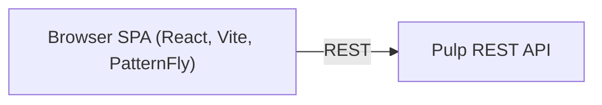

# Architecture

A high-level map of how the UI is structured. For the design decisions behind it see
[docs/adr/](../adr/); for the coding rules see [.rulesync/rules/](../../.rulesync/rules/).

## What it is

A React single-page app (Vite, TypeScript, PatternFly), rendered in the browser, that drives Pulp
entirely through its public REST API ([ADR 0007](../adr/0007-rest-api-only.md)).

## Plugin-agnostic by design

Pulp has many plugins (file, rpm, container, …) that share the same concepts: remotes,
repositories, publications, distributions, content and tasks. The UI has **one generic screen
per concept** rather than a screen per plugin. What differs between plugins — which capabilities
exist, how content is presented — is **declared as data** in the catalog and plugged into the
generic screens ([ADR 0001](../adr/0001-plugin-specifics-are-data.md)), with per-plugin create
and edit forms ([ADR 0010](../adr/0010-plugin-form-pages.md)).

Everything about one plugin lives in its folder, `client/src/plugins/<id>/`: a **definition**
(facts about Pulp: its types, endpoints and capabilities) and a **UI** (labels, forms, content
panels, Browse views, snippets), whose required shape the compiler derives from the definition.
Generic screens read facts from `@catalog` and UI from `@plugins`, never a plugin's files.
Supporting a new plugin is one folder plus two registry entries, and `tsc` lists whatever is
missing (see [plugins](plugins.md)).

## Domain-scoped

Most areas operate within a selected domain, Pulp's unit of multi-tenancy; the chosen domain is
part of the URL and the navigation ([ADR 0002](../adr/0002-navigation-and-domains.md)).

## Asynchronous by nature

Many writes (sync, publish, content changes, …) return a background task. The UI tracks the
task and refreshes the affected views once it settles, so the user sees progress and the eventual
result without reloading ([ADR 0006](../adr/0006-async-task-feedback.md)).

## Permission-aware

Actions the current user can't run stay visible but disabled, with a tooltip saying why
([ADR 0008](../adr/0008-permission-aware-actions.md)).
