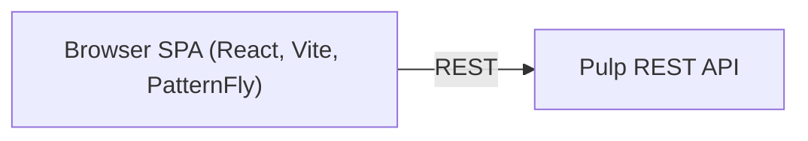

# Architecture

A high-level map of how the UI is structured. For the design decisions behind it see
[docs/adr/](../adr/); for the coding rules see [.rulesync/rules/](../../.rulesync/rules/).

## What it is

A React single-page app (Vite, TypeScript, PatternFly) that drives Pulp entirely through its
public REST API — no private endpoints, no server-side rendering of app state
([ADR 0010](../adr/0010-rest-api-only.md)).

## Plugin-agnostic by design

Pulp has many plugins (file, rpm, container, …) that share the same concepts: remotes,
repositories, publications, distributions, content and tasks. The UI has **one generic screen
per concept** rather than a screen per plugin. What differs between plugins — form fields, which
capabilities exist, how content is presented — is **declared as data** and plugged into the
generic screens. Supporting a new plugin is a data change, not a new section of the app
([ADR 0001](../adr/0001-plugin-agnostic-generic-pages.md)).

## Domain-scoped

Most areas operate within a selected domain, Pulp's unit of multi-tenancy; the chosen domain is
part of the URL and the navigation ([ADR 0002](../adr/0002-navigation-and-domains.md)).

## Asynchronous by nature

Many writes (sync, publish, content changes, …) don't finish inline — they return a background
task. The UI tracks the task and refreshes the affected views once it settles, so the user sees
progress and the eventual result without reloading ([ADR 0008](../adr/0008-async-task-feedback.md)).

## Permission-aware

Actions are shown and enabled according to what the current user is allowed to do, so the UI
never offers an operation the server would reject ([ADR 0011](../adr/0011-permission-aware-actions.md)).
